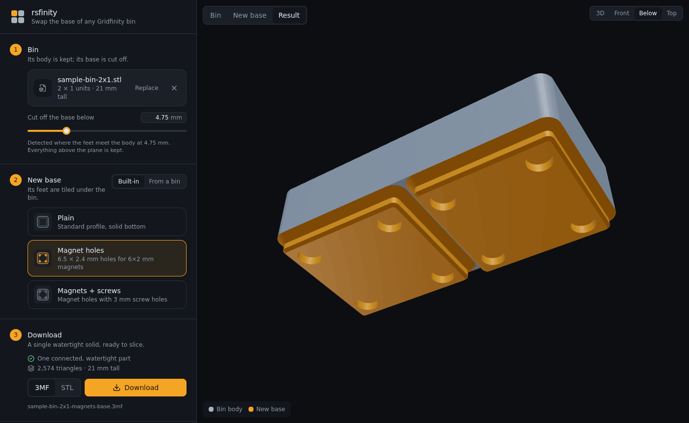

# rsfinity

rsfinity swaps the base of a Gridfinity bin. It's for when you've found a bin
you like but want different feet, say magnet holes, or want every bin in a
drawer to share the same base. Load the bin, pick a new base and download one
printable model. It runs entirely in the browser; your files never leave your
machine.

A hosted copy lives at https://rsfinity.fruitiex.org.



## What it does

Drop in a bin as STL or 3MF (Bambu, Orca and Prusa project files work too).
rsfinity works out its grid size and where the feet meet the body, and you can
nudge that cut height if it guesses wrong. Then choose a new base:

- one of the built-in bases: plain, 6×2 mm magnet holes, or magnets plus 3 mm
  screw holes;
- or the base of another bin. A 1×1 donor is enough, since its feet get tiled
  under the whole bin, and corner features such as corner magnets end up on
  the corners.

The result is one watertight solid, downloadable as 3MF or STL. Half-unit bins
are handled with half-grid (21 mm) feet.

The geometry is done with [manifold-3d](https://github.com/elalish/manifold) in
a web worker, and the viewer uses three.js. [docs/how-it-works.md](docs/how-it-works.md)
describes the analysis and swap steps.

## Running it locally

The repo has a Nix dev shell with Node and OpenSCAD:

```bash
nix develop
npm install
npm run dev        # http://localhost:5173
npm run build      # static site in dist/
```

The build uses relative paths, so `dist/` can be served from any static host
or subdirectory.

## Deploying

Every push to `main` that passes CI publishes a container image,
`ghcr.io/fruitiex/rsfinity`, which serves the static site with nginx on port
8080. Run it behind whatever reverse proxy you already have:

```bash
docker run -p 8080:8080 ghcr.io/fruitiex/rsfinity:main
```

## Tests

```bash
npm test           # geometry tests against generated bins
npm run build && npm run test:e2e   # Playwright smoke test against dist/
```

On NixOS, point the smoke test at nixpkgs' Chromium with
`SMOKE_CHROMIUM_PATH=$(command -v chromium)`.

To test against real models, set `RSFINITY_MODELS` to a directory of bins and
`src/geometry/__tests__/real-models.test.ts` will swap every pair. You can
generate bins with
[gridfinity-rebuilt-openscad](https://github.com/kennetek/gridfinity-rebuilt-openscad):

```bash
openscad --backend=manifold -o bin-3x2.stl -D gridx=3 -D gridy=2 gridfinity-rebuilt-bins.scad
RSFINITY_MODELS=/path/to/models npm test
```
